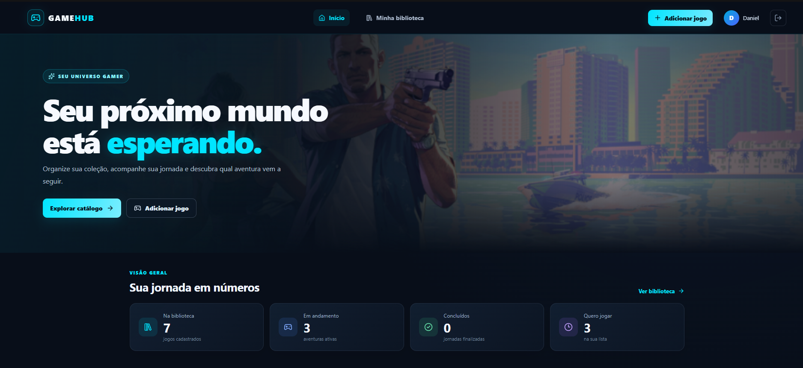

# GameHub

**GameHub** é uma aplicação web para gerenciamento de jogos, desenvolvida com a stack MERN (MongoDB, Express, React e Node.js). O projeto permite que usuários gerenciem sua biblioteca de jogos por meio de uma interface com identidade visual gamer, tema escuro e detalhes em neon.

O projeto faz parte de uma atividade acadêmica de **Design e Componentização Front-end com Inteligência Artificial**, utilizando ferramentas de IA para apoiar a criação do protótipo e o desenvolvimento da interface.

## Funcionalidades

### Usuários e autenticação
- Cadastro de usuários.
- Login com autenticação JWT.
- Proteção de senhas com bcrypt.
- Rotas protegidas por middleware de autenticação.
- Associação dos jogos ao usuário autenticado.

### Gerenciamento de jogos
- Cadastro de jogos.
- Listagem dos jogos cadastrados.
- Consulta de um jogo específico.
- Edição de jogos.
- Exclusão de jogos.
- Validações de dados com Mongoose.
- Comunicação entre o front-end e a API REST utilizando Axios.

### Interface
- Dashboard inicial com identidade visual gamer.
- Tema escuro com detalhes em azul e ciano neon.
- Componentes React reutilizáveis.
- Navegação entre as páginas da aplicação.
- Catálogo para gerenciamento da biblioteca de jogos.
- Interface desenvolvida com React e Vite.

## Tecnologias utilizadas

| Tecnologia | Utilização |
|---|---|
| MongoDB | Banco de dados NoSQL |
| Express.js | Construção da API REST |
| React | Construção da interface |
| Node.js | Ambiente de execução do backend |
| Vite | Desenvolvimento e build do frontend |
| Mongoose | Modelagem e validação dos dados |
| Axios | Requisições HTTP para a API |
| React Router | Navegação entre páginas |
| JWT | Autenticação de usuários |
| bcrypt | Proteção de senhas |
| Lucide React | Ícones da interface |
| Docker Compose | Opção de execução dos serviços em contêineres |

## Estrutura do projeto

```text
GameHub/
├── backend/
│   ├── ...
│   └── package.json
├── frontend/
│   ├── src/
│   │   ├── components/
│   │   ├── pages/
│   │   ├── services/
│   │   ├── App.jsx
│   │   ├── main.jsx
│   │   └── index.css
│   └── package.json
├── docker-compose.yml
└── README.md
```

- `backend/`: API REST, autenticação, regras de negócio e integração com MongoDB.
- `frontend/`: aplicação React com Vite, páginas, componentes reutilizáveis e integração com a API.
- `docker-compose.yml`: configuração para execução opcional dos serviços com Docker.

## Como executar localmente

### Pré-requisitos

- Node.js e npm instalados.
- MongoDB local ou uma instância acessível.
- Git, caso queira clonar o repositório.

### 1. Clonar o repositório

```bash
git clone https://github.com/danielcrp05-cpu/GameHub.git
cd GameHub
```

### 2. Configurar e executar o backend

Abra um terminal na raiz do projeto e execute:

```bash
cd backend
npm install
```

Se existir o arquivo `.env.example`, copie-o para `.env`:

```bash
cp .env.example .env
```

No Windows PowerShell, também é possível utilizar:

```powershell
Copy-Item .env.example .env
```

Configure as variáveis de ambiente necessárias, incluindo a conexão com o MongoDB e uma chave JWT segura, conforme a configuração do backend.

Inicie o servidor:

```bash
npm run dev
```

### 3. Configurar e executar o frontend

Abra outro terminal:

```bash
cd frontend
npm install
```

Se existir o arquivo `.env.example`, copie-o para `.env`:

```bash
cp .env.example .env
```

Configure a URL da API conforme as variáveis utilizadas pelo projeto.

Inicie o ambiente de desenvolvimento:

```bash
npm run dev
```

O Vite exibirá no terminal o endereço local para acessar a aplicação, normalmente `http://localhost:5173`.

> **Importante:** o backend e o MongoDB precisam estar configurados e disponíveis para que as funcionalidades dependentes da API funcionem corretamente.

### 4. Gerar o build do frontend

Na pasta `frontend`, execute:

```bash
npm run build
```

Esse comando verifica a compilação da aplicação para produção.

## API REST

As rotas abaixo representam os endpoints documentados neste README. A disponibilidade exata deve ser conferida na implementação do backend.

### Autenticação

| Método | Endpoint | Descrição |
|---|---|---|
| POST | `/api/auth/register` | Cadastro de usuário |
| POST | `/api/auth/login` | Autenticação de usuário |

### Jogos

As rotas de jogos exigem autenticação por token JWT, enviado no cabeçalho HTTP:

```http
Authorization: Bearer <token>
```

| Método | Endpoint | Descrição |
|---|---|---|
| POST | `/api/games` | Cadastrar jogo |
| GET | `/api/games` | Listar jogos do usuário autenticado |
| GET | `/api/games/:id` | Consultar jogo específico |
| PUT | `/api/games/:id` | Atualizar jogo |
| DELETE | `/api/games/:id` | Excluir jogo |

## Design e desenvolvimento com IA

A atividade utiliza ferramentas de inteligência artificial como apoio ao processo de concepção visual e desenvolvimento da interface.

### Processo de criação

1. **Planejamento visual:** definição da proposta visual do GameHub, com tema gamer, fundo escuro e cores neon.
2. **Prototipação:** exploração de referências e propostas de interface utilizando ferramentas de IA.
3. **Geração da interface:** utilização do v0 para gerar uma proposta de dashboard.
4. **Adaptação ao projeto:** adequação da interface gerada à estrutura existente, mantendo React, JavaScript e Vite.
5. **Integração:** conexão dos componentes visuais aos dados e funcionalidades já disponibilizados pelo backend.
6. **Validação:** execução da aplicação e verificação do build.

### Ferramentas utilizadas

- **Google Stitch:** exploração e prototipação visual da interface.
- **v0 by Vercel:** geração de uma proposta de dashboard e componentes de interface.
- **ChatGPT:** apoio à análise, adaptação e integração da interface ao projeto existente.

### Prompts utilizados

- **Google Stitch:** Design a high-fidelity, modern, responsive web interface for GameHub, a personal video game library and game collection management platform.
Visual Style


Use a dark gaming aesthetic with a deep navy background (#081321).

Use neon cyan (#00F0FF) as the primary accent color, combined with electric blue highlights.

Add subtle neon glows, soft shadows, smooth rounded corners, and modern typography.

The interface should feel premium, futuristic, immersive, and inspired by modern gaming platforms.

Maintain excellent readability, visual hierarchy, and contrast.
Main Layout


Navigation Bar: Create a sleek navigation bar with the GameHub logo, links for Home, My Library, Game Catalog, and a user profile section.

Hero Section: Include a large welcome banner with the headline "Your Gaming Universe", a short subtitle about organizing and discovering games, and a prominent cyan call-to-action button labeled "Explore Games".

Library Statistics: Display three compact statistic cards showing Total Games, Currently Playing, and Completed Games. Use simple icons and clear numbers.

Game Collection: Create a responsive grid of attractive game cards featuring cover artwork, game title, genre, rating, and completion status. Include these games:


Elden Ring — Action RPG

God of War Ragnarök — Action Adventure

Cyberpunk 2077 — Open-World RPG

Red Dead Redemption 2 — Action Adventure

Hollow Knight — Metroidvania

Forza Horizon 5 — Racing

Game Cards: Each card should include a high-quality cover image, a dark gradient overlay, readable text, a small genre label, and a clear status badge such as "Playing", "Completed", or "Want to Play". Add subtle hover effects and cyan highlights.

Search and Filters: Add a search field and filter controls to help users find games by genre or status.

Footer: Include a minimal footer consistent with the gaming aesthetic.
Component-Based Design Structure the interface around reusable components such as Navbar, HeroBanner, StatisticsCard, GameCard, SearchBar, FilterMenu, and Footer. Keep the layout organized and consistent.
Responsive Design Ensure the interface adapts smoothly to desktop, tablet, and mobile screens. On smaller screens, use a collapsible navigation menu and a responsive game grid.
Important Requirements


Use realistic gaming content instead of Lorem Ipsum.

Prioritize visual quality, usability, accessibility, and consistency.

Make the game cover images visually prominent.

Keep the design clean and organized without excessive visual effects.

Generate a complete, polished UI prototype suitable for implementation with React and Tailwind CSS.
Create the main GameHub dashboard screen as the primary design, with a strong focus on the game collection and the neon gaming aesthetic.
- **v0 by Vercel:** Build a modern, responsive gaming dashboard for a project called GameHub using React and Tailwind CSS.  Use the following design direction: - Dark navy background (#081321). - Neon cyan primary accent (#00F0FF). - Electric blue highlights and subtle glow effects. - Modern typography, rounded cards, soft shadows, and a premium gaming aesthetic.  Create the main dashboard with these reusable React components: 1. Navbar — GameHub logo, Home, My Library, Game Catalog, and user profile. 2. HeroBanner — title "Your Gaming Universe", subtitle, and an "Explore Games" button. 3. StatisticsCard — total games, currently playing, and completed games. 4. SearchBar — search games by title. 5. FilterMenu — filter games by genre and completion status. 6. GameCard — cover image, title, genre, rating, and status badge. 7. GameGrid — responsive grid that renders GameCard components. 8. Footer — minimal footer matching the theme.  Use these six example games: - Elden Ring — Action RPG - God of War Ragnarök — Action Adventure - Cyberpunk 2077 — Open-World RPG - Red Dead Redemption 2 — Action Adventure - Hollow Knight — Metroidvania - Forza Horizon 5 — Racing  Requirements: - Use React functional components and JavaScript. - Use Tailwind CSS for styling. - Store the example games in an array of JavaScript objects using React useState. - Render the games dynamically with map(), using a unique key for each item. - Implement working search and genre/status filters. - Use reusable components with props. - Use responsive layouts for desktop, tablet, and mobile. - Use realistic game cover artwork and avoid Lorem Ipsum. - Keep the code clean, accessible, and easy to integrate into an existing Vite React project. - Do not create a backend or database; use mock data only.  Generate the dashboard UI and its component code. Explain which files contain each component and any dependencies required. 

## Captura de tela


## Objetivos acadêmicos

O projeto busca aplicar os conceitos de desenvolvimento de interfaces com React, componentização, reutilização de código, integração com uma API e uso de ferramentas de inteligência artificial no processo de design e desenvolvimento.

Na entrega, devem ser conferidos os seguintes requisitos da atividade:

- Utilização de React com Vite e JavaScript.
- Organização do código em componentes reutilizáveis.
- Utilização de pelo menos três componentes reutilizáveis.
- Uso de pelo menos seis objetos de dados JSON armazenados em `useState`, conforme solicitado na atividade.
- Renderização de listas com `.map()` e identificadores únicos na propriedade `key`.
- Registro dos prompts utilizados nas ferramentas de IA.
- Inclusão de captura de tela da interface final.
- Repositório público no GitHub e histórico de commits.

**Observação:** o requisito de seis objetos JSON em `useState` deve ser conferido no código final. Os jogos carregados da API não devem ser substituídos por dados fictícios apenas para cumprir esse requisito. Caso necessário, a atividade deve ser atendida em um contexto de demonstração separado e claramente identificado.

## Segurança

- Não publique arquivos `.env` com credenciais.
- Não compartilhe senhas, tokens JWT ou chaves privadas.
- Utilize variáveis de ambiente para configurações sensíveis.
- Configure o MongoDB e as permissões de acesso adequadamente.

## Repositório

GitHub: https://github.com/danielcrp05-cpu/GameHub

---

**GameHub — sua biblioteca de jogos em um só lugar.**